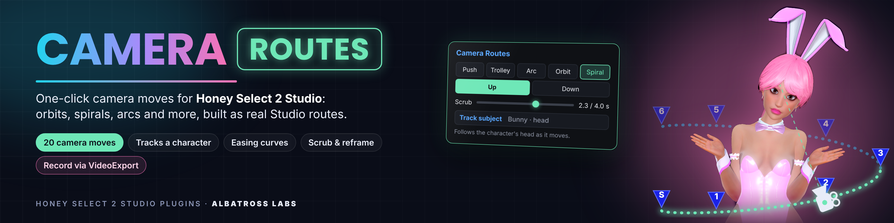
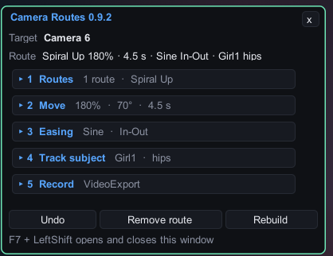
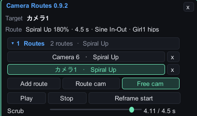
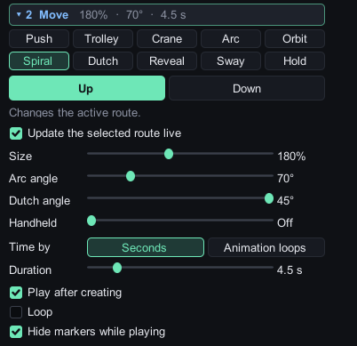
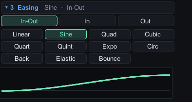
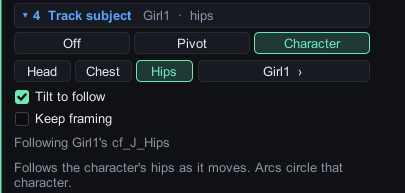
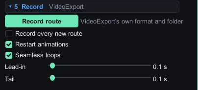

# HS2CameraRoutes

Easy method to add simple camera routes with easing and tracking.

Camera Routes gives Honey Select 2 Studio one-click camera moves: push in, pull out, crane, trolley, arcs, orbits, spirals, Dutch rolls and more. Each move is built as an ordinary Studio route with the camera hung on it, so it saves with the scene, plays from the Route Controller and can still be edited in Route Settings like a route you made by hand. While a route plays, the camera keeps looking at its subject: a fixed point, or a character it follows as she moves. Every action can be undone, and any route records to video in one click.

By **Albatross Labs**.

<!--  -->

## Features

- **20 camera moves in two clicks.** Pick a type (Push, Trolley, Crane, Arc, Orbit, Spiral, Dutch, Reveal, Sway, Hold), then a direction. The move is built from the current shot, so "left" and "forward" follow what you framed.
- **Real Studio routes.** Moves save with the scene, play from Studio's Route Controller and stay editable in Route Settings. Routes you made by hand are never touched.
- **Subject tracking.** The camera keeps a fixed pivot or a character's head, chest or hips in frame while it moves, and follows the character if she moves. Turn off *Tilt to follow* for a level, pan-only head.
- **Even circles.** Orbits, arcs and spirals keep one distance from the subject all the way round.
- **Easing curves.** 11 curves (Sine, Cubic, Expo, Back, Elastic, Bounce and more) in In, Out or In-Out, with a live preview of the speed curve. Studio's Behavior dropdown gains all 32 of its tween engine's eases.
- **Live update.** Change Size, angles, duration, easing or tracking and the route rebuilds and replays as you let go of the slider. One Undo takes back the whole round of tweaks.
- **Several routes per scene.** A routes list with an active route, Add route when you want another, and a Route cam / Free cam switch to look through a route's camera or watch it from outside.
- **Scrub and reframe.** Drag the Scrub slider to any moment of a move, in either camera. Reframe start lets you pick a new starting shot with your normal camera controls and rebuilds the move from there.
- **Dutch roll and handheld shake** on any move, repeatable so every take matches.
- **Timed to animations.** Set a move's length in animation loops; every character's animation restarts with the route, so camera and motion stay in step.
- **One-click recording** through VideoExport, with lead-in and tail. Looping routes record exactly one cycle for seamless loops.
- **Undo** (30 steps) for every action, including replaced routes, which come back exactly as they were.
- **Hidden markers.** Route lines and point markers hide while a route plays and while recording, so they never show in the shot.
- **The Albatross Labs look.** Same theme as Studio Browser and Camera Sweep, with numbered fold-out sections, hover hints, a toolbar button and a remembered window position.

## Use cases

- **Visual novel scenes.** Build establishing shots, character introductions (Push In on the face), reveals and slow Dutch rolls for tense moments, then record them as clips for Ren'Py or another engine.
- **Living backgrounds.** A Hold with a little Handheld, or a Sway timed to the idle animation, keeps a talking scene from looking frozen. Record one seamless cycle and loop it behind the dialogue.
- **Character and outfit showcases.** Orbit or Spiral around a card for a turntable video or GIF for itch, F95 or Discord.
- **Animated scenes.** Time an Orbit to an animation's loops and the camera and the animation both loop cleanly in one recording.
- **Trailers and previews.** String several routes together on different cameras and record each move with the same settings.
- **Fast iteration.** Try a move, scrub it, change the easing or size, reframe the start, and compare. Nothing has to be rebuilt by hand.

## Install

1. You need BepInEx 5 and the Modding API (HS2API). BetterRepack includes both.
2. Put `HS2CameraRoutes.dll` in `BepInEx\plugins\AlbatrossLabs\HS2CameraRoutes\`.
3. Optional: ExtensibleSaveFormat (saves each route's tracking and settings with the scene) and VideoExport (recording). Both come with BetterRepack and are found automatically.

## Quick start

1. Open Studio and frame a shot of your character with the normal camera.
2. Open Camera Routes with the button on Studio's left toolbar, **Shift+F7**, or the route button in the Route Controller.
3. Click a character in the workspace to make her the subject.
4. In **2 Move**, click **Spiral**, then **Up**. A new camera appears on a spiral route and the move plays through it.
5. Drag **Size**, **Duration** or an easing curve and watch the route rebuild. Use **Scrub** to check any moment, and **Record route** when it looks right.

<!--  -->

## The window



Along the top: the target camera and the active route's settings. Five numbered sections fold open and shut, each with a one-line summary of its settings, so you can fold away what you don't use. Along the bottom: **Undo** (hover it to see what it undoes), **Remove route**, **Rebuild**, and a status line that also explains whatever is under the pointer. Studio's shortcut keys are paused while the pointer is over the window. It works with IMGUI scaling plugins and remembers where you left it.

### 1 Routes



Lists every Camera Routes route in the scene. The highlighted one is the **active route**, the one the move picker changes. Click a route in the list (or select it, one of its points or its camera in the workspace) to make it active.

- **Add route** makes a new camera at the current view with the move picked below. New routes only come from Add route, or from your very first move in a scene with none, so clicking another move changes the active route and never piles up cameras.
- **Route cam / Free cam** switches the viewport between the active route's camera and Studio's own free camera. In Route cam the view follows the active route: switch routes and it switches cameras. In Free cam it stays put so you can watch the routes from outside.
- **x** on a row removes that route. The camera stays, and Undo brings the route back.
- **Play** runs the active route from its start; **Stop** parks the camera back at the start.
- **Scrub** moves the camera to any moment of the route, with tracking, roll and handheld applied as they would be then. It follows along while the route plays; dragging it stops playback.
- **Reframe start** changes where the move begins. The camera parks at its start and the viewport steps into Studio's free camera at the same shot. Frame the new starting shot with your usual controls (Camera Nav included), then click **Use this view**: the route rebuilds from there with the same settings. *Cancel* leaves the route as it was.

Selecting a **character, item, light or folder** in the workspace makes it the subject the active route's camera looks at. (*F1 > Selected character or item = MoveIt* makes the selected object ride the route instead.)

<!--  -->

### 2 Move



Pick a type, then a direction. Clicking a direction builds that move on the active route, and the active route's direction is highlighted.

- **Update the selected route live** (on): change any setting and the route rebuilds as soon as you let go, and plays if *Play after creating* is on. Off: change settings freely, then press **Rebuild**.
- **Size:** how far the move goes, as a share of its default (see [Moves](#moves)).
- **Arc angle:** degrees for Arc moves (5–300°).
- **Dutch angle:** roll for Dutch moves (1–45°).
- **Handheld** (Off to 3): subtle handheld shake on any move, about ±0.6° at 1. It's driven by time since the route started, so every take shakes the same way.
- **Time by:** Seconds, or Animation loops (see [Time by animation loops](#time-by-animation-loops)).
- **Duration** (or **Loops**): the length of the whole move, one lap for an Orbit.
- **Play after creating**, **Loop** (straight moves go back and forth; arcs play once; Orbit and Sway always loop), **Hide markers while playing**.

<!--  -->

### 3 Easing



A mode (In-Out, In, Out) and a curve (Linear, Sine, Quad, Cubic, Quart, Quint, Expo, Circ, Back, Elastic, Bounce), with a preview of the speed curve. Linear runs at constant speed. Orbits always run at constant speed so their laps join cleanly.

<!--  -->

### 4 Track subject



| Option | The camera keeps looking at |
|---|---|
| **Off** | Nothing: straight moves keep their original aim. Curved moves still face the pivot. |
| **Pivot** (default) | The fixed point it was framed on when the route was made (Studio's camera pivot). Best for a subject that doesn't move. A trolley pans to keep it in frame, a crane tilts. |
| **Character** | A character's **Head**, **Chest** or **Hips**, followed as she moves. The nearest character to the line of sight is picked; the name button cycles to the next one. Arcs circle that character. |

- **Tilt to follow** (on): the camera pans and tilts to keep the subject in view. Off: it only pans, keeping the tilt it starts with, like a camera on a level head.
- **Keep framing** (off): the camera turns to face the subject as the route is made and keeps it centred. On: the subject stays where it was in the frame, off to one side for the rule of thirds.
- The section shows exactly which bone is being followed. If a character has no head, chest or hips bone the plugin can find, it says so in yellow and follows the character's root instead.

Tracking runs while the route plays. Picking a Correct Aim other than None in Route Settings hands aiming back to Studio.

<!--  -->

### 5 Record



**Record route** drives VideoExport, which uses its own format, size, frame rate and output folder:

1. VideoExport starts, and Camera Routes waits until it's really capturing frames.
2. The route parks at its start, every character's animation restarts (*Restart animations*), and after the **Lead-in** the route plays.
3. Recording stops once the route has finished, plus the **Tail**, and VideoExport encodes the video.

- **Seamless loops** (on): looping routes (Orbit, Sway, looping straight moves) record exactly one cycle with no lead-in or tail, so the video loops cleanly.
- **Record every new route** records each route as soon as it's made.

VideoExport fixes the game to its capture frame rate while recording, so the move takes exactly its duration in the video however slow the render is. Its own length limit is switched off during a Camera Routes recording and restored afterwards. *Stop recording* (or VideoExport's own Ctrl+Shift+E) ends it early.

<!--  -->

## Moves

| Move | What it does | Sized by |
|---|---|---|
| Push In | Toward the subject along the view, pitch included | Size (100% = 40% of the distance to the subject) |
| Pull Out | Back along the view | Size (60%) |
| Reveal | Pull back while rising | Size (60%) |
| Crane Up / Down | Straight up or down | Size (40%) |
| Trolley Left / Right | Sideways, level with the ground | Size (50%) |
| Trolley Up / Down | Along the camera's own up, so it tilts with the shot (Crane goes straight up and down) | Size (40%) |
| Arc Left / Right | Circles the subject, still looking at it | Arc angle |
| Arc Up / Down | Swings over or under the subject, still looking at it; stops 10° short of straight above or below | Arc angle |
| Orbit Left / Right | Full circle around the subject, looping | — |
| Spiral Up / Down | One full circle around the subject while rising or sinking | Size (height = 50% of the distance) |
| Dutch Left / Right | Slow push in while the camera rolls; the roll follows the move's easing | Size (15%), Dutch angle |
| Sway | Looping pendulum swing left and right around the subject, slowing at each end; made for idle loops | ± half the Arc angle |
| Hold | Stays put for the duration; pair it with Handheld | — |

"The subject" is what the camera is looking at: the selected character or item, or the point on its line of sight level with Studio's camera pivot. If you framed a shot with the normal viewport camera, that's what you framed.

Applying another move to the same route replaces it, starts again from where that route began, and keeps its subject unless you've selected a new one.

## Time by animation loops

Set **Time by** to *Animation loops* and the move's duration becomes *Loops* × one loop of a character's current animation (at its current speed). The character is the tracked one when Track is Character, otherwise the one nearest the line of sight; the window shows what it works out to ("= 3.46 s (Hana: 1.73 s per loop)"). When such a route starts playing, every character's animation restarts with it, so the camera and the animation stay in step. Time an Orbit this way and record it: a seamless loop in one click. Change the animation or its speed and rebuild the route to re-time it.

## Undo and Remove route

- **Undo** reverses the last Camera Routes action: a new route and camera are deleted, a replaced route comes back exactly as it was (hand edits included), and a camera taken out of a folder goes back into it. Up to 30 steps; cleared when a scene loads.
- **Remove route** takes the camera off its route (it stays where the route starts), deletes the route and puts the camera back where it hung before. Undoable.

## Settings (F1 > Camera Routes)

Everything in the window is also in F1, plus:

- **General:** toggle key (Shift+F7), Undo and Play hotkeys (not bound by default), the Route Controller button and the toolbar button.
- **Subject:** Keep framing.
- **Advanced:** Size mode (share of subject distance, or fixed Studio units), fixed base distance, fallback subject distance, look through a new camera, replace the previous route, what a selected character or item does (LookAtIt / MoveIt), motion line on/off and its color.
- **Recording:** restart animations, record every new route, lead-in, tail, seamless loops.

## How the routes are built

- The route starts where the camera is and is turned to face the view (straight moves) or the direction of travel (curved moves). Points are placed in that frame, so "left" and "forward" follow the shot.
- **Straight moves** are one segment carrying the chosen ease; Studio's tween engine applies it over the whole move.
- **Curved moves** (arcs, orbits, spirals, sway) are sampled every 15° (full circles: 24 points) into Studio points with the *Curve* shape and the control point on the path, so the camera keeps one distance from the subject all the way round. With easing on, the first stretch eases in, the last eases out, and the ones between run at the speed the ease hands over at, so there's no jump in speed. Sway eases out into each far end and back in through the middle.
- **Aiming, roll and shake:** while a route plays, Camera Routes turns the camera every frame to look at the subject, then adds the Dutch roll (by how far along the route it is) and the handheld shake. These routes leave *Correct Aim* on None; picking XY or Y in Route Settings hands aiming back to Studio, which turns in steps at each point.
- **Speeds** are set per segment so the whole route takes *Duration* seconds. Studio moves a route at speed × 10 units per second, and segment lengths are measured exactly the way its tween engine measures them (iTween's Catmull-Rom path length), so curved moves finish on time. The scrubber and the recorder use the same model.
- **Saved data:** each route's record (move, subject, pivot, character, framing, settings, original parent) is saved inside the scene file through ExtensibleSaveFormat, so tracking, live update and Remove route work after reloading. Imported scenes are matched up by route position. Without ExtensibleSaveFormat the plugin still works, but records last only until the scene is closed.
- **Studio's Behavior dropdown** (Route Point Settings) normally lists 6 eases. Camera Routes adds the other 26 its tween engine supports after Studio's own six, so existing scenes are unchanged.

## Known limits (0.9.2)

- **Zoom is a push-in.** Routes move objects; they can't change a camera's lens (FOV).
- **Studio's viewport camera can't ride a route.** Moves always use a camera object (or an item); Add route makes a new camera at the current view.
- **Aiming, roll and shake need the plugin** and run only while the route plays. Load a scene without Camera Routes and cameras still move along their routes but don't turn. A stopped route parks the camera at its start with its original aim.
- **Horizontal arcs keep the camera's height;** vertical arcs keep its distance and stop 10° short of straight above or below.
- **Looping arcs** aren't offered: Studio returns along a straight line back to the start. Use Orbit or Sway.
- **Moving past the subject** (Push In at a very large Size with Pivot tracking) flips the camera round to keep looking at it.
- **Loop length is read when the route is built.** Change the animation or its speed afterwards and rebuild the route to re-time it.
- **Restarting animations restarts all characters,** so pairs stay in sync; a character partway through a one-off animation starts it again.
- **Recording a hand-made route** works if it doesn't loop. Looping hand-made routes have no known cycle length.
- **Routes are recognised by the "Cam Route: " name prefix.** Renaming one detaches it from its record.
- **Imported scenes:** character subjects are found again by name.

## Build

```
dotnet build -c Release
```

References come from the game install (`HS2Dir`, default `X:\HS2 RX15`), and the build copies the DLL to `BepInEx\plugins\AlbatrossLabs\HS2CameraRoutes\` there. Override with `-p:HS2Dir="..."`, or skip the copy with `-p:Deploy=false`.

Needs BepInEx 5 and the Modding API (HS2API, for the toolbar button). ExtensibleSaveFormat (BepisPlugins) and VideoExport (HSPlugins) are used when present, through reflection, so there are no build references to them.

```
src/CameraRoutesPlugin.cs   config, hotkeys, routes list, applying a move, live update, scrub, reframe
src/Presets.cs              move list and the route planner (points, curve aids, eases, speeds)
src/RoutePath.cs            Studio's tween path model (length, position at a time)
src/Easing.cs               ease curves (preview, speed matching, mapping to Studio's ease types)
src/RouteRecord.cs          per-route record, its text form, and the scene's record registry
src/SceneData.cs            saving/loading records with the scene (ExtensibleSaveFormat), new-scene reset
src/Subjects.cs             characters and their head / chest / hips bones
src/Tracker.cs              aims cameras at their subject while routes play, hides markers
src/UndoStack.cs            undo entries and route snapshots
src/AnimLoops.cs            animation loop length, restarting all characters' animations
src/Recorder.cs             recording a route with VideoExport (by reflection)
src/ArcAimer.cs             fallback aiming for routes without a record
src/StudioEaseList.cs       adds the missing eases to Studio's Behavior dropdown
src/UI/Theme.cs             the shared Albatross Labs skin (copied from Studio Browser; keep them in step)
src/UI/Support.cs           relayout helper, shortcut-key guard, toolbar button and icon
src/RouteBuilder.cs         target selection, new camera at the view, building the Studio route
src/PresetWindow.cs         the window
src/ControllerButton.cs     the button in Studio's Route Controller
```

The banner, social preview and Discord images are made from `docs/images/source/banner.html`; see the README there.

## Changes

- **0.9.2:** Route cam follows the active route (switching routes used to leave the view on the previous route's camera); the Scrub slider now really moves the camera (a stopped route used to snap it back to its start every frame); Reframe start works on any route.
- **0.9.1:** orbits, spirals and arcs use a point every 15° (was 22.5°–30°), so they stay at one distance from the subject; a new route starts playing on the next frame, aimed at its subject from the first frame.
- **0.9.0:** routes list with an active route: moves change the active route, and new routes come only from Add route (or your first move); Route cam / Free cam switch; compact type → direction move picker; Orbit Right; Undo button just says Undo. Fixed: switching Track to Character on an existing route kept aiming at the old fixed pivot.
- **0.8.0:** Trolley Up / Down; Tilt to follow (off = pan only); the Track section shows which bone is followed and warns when it falls back to the character's root; Reframe start → Use this view; Undo of a replaced route puts the camera back exactly where it started.
- **0.7.0:** live update with one Undo per round of tweaks, and a Rebuild button for when it's off; Scrub slider; recordings run until the route really finishes; curved segments timed exactly as Studio measures them.
- **0.6.3:** route lines and point markers hide while a Camera Routes route plays, and all routes' while recording.
- **0.6.2:** tracking turns the camera to face the subject and keeps it centred; Keep framing in F1 for the old behaviour; Play / Stop buttons and an optional hotkey.
- **0.6.1:** a selected character, item, light or folder is the subject the camera looks at (it used to be put on the route); replacing a route keeps its subject; F1 option to move the selected object instead.
- **0.6.0:** the Studio Browser / Camera Sweep look: shared theme, numbered fold-out sections with summaries, hover hints; toolbar button; shortcut keys paused over the window; window position remembered; IMGUI scaling. Needs the Modding API.
- **0.5.0:** Arc Up / Down, Spiral Up / Down, Dutch Left / Right, Sway, Hold; Handheld shake for any move.
- **0.4.0:** time moves in animation loops; record a route with VideoExport in one click, with seamless one-cycle recordings for looping routes.
- **0.3.0:** subject tracking (fixed pivot, or a character's head / chest / hips); route records saved with the scene; Undo, Remove route and Load settings.
- **0.2.0:** smooth aiming on Arc and Orbit; easing modes and curves with a preview; all of the tween engine's eases in Studio's Behavior dropdown.
- **0.1.0:** first version.
